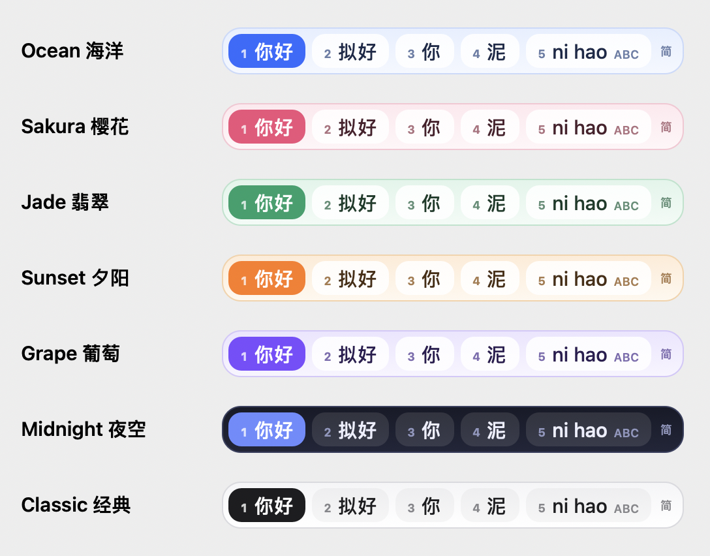

# MixKey 混打

**Type Chinese (pinyin) and English together — no more switching input methods.**

MixKey is a macOS input method that works out, word by word, whether you are typing pinyin or English:

| You type | You get |
| --- | --- |
| `ni hao` / `nihao` | 你好 |
| `wo ming tian qu port dickson` | 我明天去 Port Dickson |
| `jin tian de meeting hen boring` | 今天的 meeting 很 boring |
| `kuala lumpur hen re` | Kuala Lumpur 很热 |
| `i got reading dfiifcuilteiy` | I got reading difficulty |
| `tou fa` on a Taiwan / Hong Kong website | 頭髮 |

It is built for people who find switching keyboards tiring, and for people with reading or spelling difficulty:
big, clear candidate window, pinyin with tone marks under each choice, and automatic spelling fixes.



## How it works

1. **Local engine (instant, offline).** A pinyin word lattice over ~550k words picks the most likely Chinese
   sentence. Each word you type is scored as English or pinyin using English word frequency, whether neighbouring
   syllables form real Chinese words (`ming` + `tian` → 明天), and the words around it.
2. **English help (offline).** Place names and proper nouns are capitalised (`port dickson` → Port Dickson),
   `i` → I, sentences start with a capital, and macOS's spell checker fixes typos. Valid Malay words are left alone.
3. **Simplified or Traditional, automatically.** MixKey looks at Chinese already in the text field, the website
   address (`.tw`, `.hk`, `zh-Hant` …) and the window title, and switches to Traditional when it sees it — with
   phrase-aware conversion (头发 → 頭髮, 发展 → 發展).
4. **✨ AI assist (optional).** Add a Claude API key and, after a short pause, MixKey asks Claude to fix the whole
   sentence (homophones, spelling, names). The AI answer appears as choice 1; the local guess is always there too.
   Only the letters you are currently composing are sent — never your document. Password fields never reach input methods.

## Keys

| Key | Action |
| --- | --- |
| letters, space | keep typing (space separates words) |
| **Enter** or **Space twice** | send what is shown |
| **1–9** / click | pick a choice (picking a word keeps the rest of the sentence) |
| ↑ ↓ Tab | move through choices, ← → page |
| **Esc** | cancel |
| **Shift+Enter** | send the letters exactly as typed |
| **Tap Shift** | English-only mode on/off |
| `, . ? ! ; :` | sends, and becomes `，。？！；：` after Chinese |

Settings live in the input menu in the menu bar (the 混 icon): Simplified / Traditional / Auto, colour theme 🎨,
spacing between Chinese and English, capitalisation, spelling fixes, pinyin hints, text size, AI assist,
the Claude API key, and "Forget words MixKey learned".

## Install (macOS 13+, Apple Silicon or Intel)

Needs Xcode (or the Command Line Tools) and Python 3.

```bash
git clone https://github.com/mokyiichek/mixkey.git
cd mixkey
scripts/install.sh
```

The script downloads the dictionary data, builds `MixKey.app`, copies it to `~/Library/Input Methods`, and
enables it. Then choose **混 MixKey (Pinyin + English)** from the input menu in the menu bar. If it isn't listed,
log out and back in, or add it in *System Settings › Keyboard › Input Sources › Edit… › + › Chinese, Simplified*.

For automatic Traditional detection on websites, choose **Allow website detection** in the MixKey menu and turn
MixKey on in *System Settings › Privacy & Security › Accessibility*.

Other scripts: `scripts/test.sh` (engine tests), `scripts/uninstall.sh`, and try the engine without installing:

```bash
swift run mixkey-cli "wo ming tian qu port dickson"
swift run mixkey-cli --trad "wo men qu kan dian ying"
```

## Project layout

```
Sources/MixKeyCore/   platform-neutral engine: lexicon, pinyin lattice, English detection, casing, 简→繁
Sources/MixKey/       macOS input method (InputMethodKit): keys, candidate window, AI, script detection
Sources/mixkey-cli/   command-line tester
tools/build_dict.py   builds build/mixkey.db (SQLite) from the downloaded data
data/lexicon/         proper nouns & place names (edit freely — Malaysian places included)
```

## Roadmap

- [x] Pinyin + English (macOS)
- [ ] Cangjie 倉頡 + English
- [ ] Learn from what you pick (personal dictionary)
- [ ] Malay and other Latin-script languages
- [ ] Windows version (Text Services Framework) sharing the same engine design

## Data & licenses

MixKey's code is released under the **GPL-3.0** (see `LICENSE`). Dictionary data is downloaded at build time and
is not stored in this repository:

- Pinyin dictionary: [rime-ice 雾凇拼音](https://github.com/iDvel/rime-ice) — GPL-3.0
- Simplified → Traditional tables: [OpenCC](https://github.com/BYVoid/OpenCC) — Apache-2.0
- English word frequency: [FrequencyWords](https://github.com/hermitdave/FrequencyWords) — CC BY-SA 4.0
